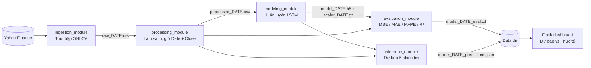

# Stock Price Forecasting MLOps Pipeline (Apache Airflow + LSTM)

Pipeline MLOps tự động chạy **hằng ngày**. Mỗi lần chạy, pipeline thu thập dữ liệu giá cổ phiếu mới nhất, huấn luyện lại mô hình **LSTM**, đánh giá trên tập test và dự báo giá đóng cửa **5 phiên giao dịch tiếp theo**. Kết quả được theo dõi trên một **dashboard Flask**, so sánh dự báo với giá thực tế khi giá thực tế xuất hiện.

Mã mặc định: `DIG.VN` (DIC Corp, HOSE). Có thể đổi sang mã khác mà không phải sửa code.

---

## Điểm nổi bật

- **Orchestration bằng Airflow (TaskFlow API):** 5 task độc lập, gồm Ingestion → Processing → Modeling → Evaluation / Inference. Mỗi task có retry, timeout và logging riêng.
- **Tự động huấn luyện lại mỗi ngày** trên dữ liệu mới, nên mô hình luôn bám theo diễn biến gần nhất của thị trường.
- **Chống data leakage:** chia train/test theo thời gian (80/20). Scaler chỉ được `fit` trên tập train. Tập test được "warm-up" bằng 60 ngày cuối của tập train.
- **Đánh giá bằng nhiều chỉ số:** MSE, MAE, MAPE, R² cho mỗi lần chạy, lưu kèm model.
- **Dự báo nhiều bước có ý thức về lịch giao dịch:** dự báo đệ quy 5 ngày và bỏ qua thứ 7, chủ nhật và ngày lễ Việt Nam (cấu hình được).
- **Cấu hình qua Airflow Variables:** mã cổ phiếu, độ dài cửa sổ, số ngày dự báo và ngày lễ đều sửa trên giao diện Airflow.
- **Dashboard theo dõi chất lượng dự báo:** gom mọi lần chạy, ghép dự báo với giá thực tế, tính MAPE/MAE theo từng run và tổng thể.

---

## Kiến trúc



| Task | Module | Đầu vào | Đầu ra |
| --- | --- | --- | --- |
| `ingestion_module` | `modules/ingestion.py` | Ticker, ngày bắt đầu, ngày chạy (`ds`) | `raw_<ds>.csv` |
| `processing_module` | `modules/processing.py` | File raw | `processed_<ds>.csv` (Date, Close, chưa scale) |
| `modeling_module` | `modules/modeling.py` | File processed | `model_<ds>.h5`, `scaler_<ds>.gz` |
| `evaluation_module` | `modules/evaluation.py` | File processed + model + scaler | `model_<ds>_eval.txt` |
| `inference_module` | `modules/inference.py` | File processed + model + scaler | `model_<ds>_predictions.json` |

`evaluation_module` và `inference_module` chạy song song sau khi huấn luyện xong.

---

## Mô hình

| Thành phần | Cấu hình |
| --- | --- |
| Đầu vào | Chuỗi 60 ngày giá đóng cửa (MinMax scale về [0, 1]) |
| Kiến trúc | LSTM(50, return_sequences) → Dropout(0.2) → LSTM(50) → Dropout(0.2) → Dense(1) |
| Huấn luyện | Adam, loss MSE, batch 32, tối đa 50 epoch, EarlyStopping (patience 10, khôi phục trọng số tốt nhất) |
| Chia dữ liệu | 80% đầu làm train, 20% cuối làm test, theo đúng thứ tự thời gian |
| Dự báo | Đệ quy: mỗi giá trị dự báo được nối vào chuỗi để dự báo bước tiếp theo |

---

## Cấu trúc thư mục

```
Airflow-du-doan-chung-khoan/
├── stock_final_dag.py      # Định nghĩa DAG (TaskFlow API)
├── modules/
│   ├── ingestion.py        # Thu thập dữ liệu từ Yahoo Finance
│   ├── processing.py       # Làm sạch dữ liệu (không scale, chống leakage)
│   ├── modeling.py         # Huấn luyện LSTM, lưu model + scaler
│   ├── evaluation.py       # Đánh giá MSE / MAE / MAPE / R²
│   └── inference.py        # Dự báo N phiên giao dịch tiếp theo
└── app.py                  # Dashboard Flask theo dõi dự báo
```

---

## Cài đặt và chạy

### 1. Môi trường

Yêu cầu Python 3.10+ và Linux/WSL (Airflow không chạy trực tiếp trên Windows).

```bash
python -m venv airflow-env
source airflow-env/bin/activate

# Cài Airflow theo constraints chính thức (thay phiên bản Python cho đúng máy)
AIRFLOW_VERSION=2.10.5
PYTHON_VERSION="$(python -c 'import sys; print(f"{sys.version_info.major}.{sys.version_info.minor}")')"
pip install "apache-airflow==${AIRFLOW_VERSION}" \
  --constraint "https://raw.githubusercontent.com/apache/airflow/constraints-${AIRFLOW_VERSION}/constraints-${PYTHON_VERSION}.txt"

# Thư viện của pipeline và dashboard
pip install -r requirements.txt
```

### 2. Đưa DAG vào Airflow

```bash
export AIRFLOW_HOME=~/airflow
git clone https://github.com/Ducanh271/Airflow-du-doan-chung-khoan.git
cp -r Airflow-du-doan-chung-khoan/stock_final_dag.py Airflow-du-doan-chung-khoan/modules $AIRFLOW_HOME/dags/
```

### 3. Cấu hình (tùy chọn)

Vào **Admin → Variables** trên giao diện Airflow. Biến nào không khai báo sẽ dùng giá trị mặc định.

| Variable | Mặc định | Ý nghĩa |
| --- | --- | --- |
| `stock_ticker` | `DIG.VN` | Mã cổ phiếu (định dạng Yahoo Finance) |
| `stock_start_date` | `2023-01-01` | Ngày bắt đầu lấy dữ liệu |
| `stock_seq_length` | `60` | Số ngày trong một chuỗi đầu vào |
| `stock_days_predict` | `5` | Số phiên giao dịch cần dự báo |
| `stock_holidays` | `2026-04-30,2026-05-01,2026-09-02` | Ngày nghỉ lễ, cách nhau bằng dấu phẩy |
| `stock_data_dir` | `~/airflow/data/stock` | Thư mục lưu dữ liệu, model và kết quả |

### 4. Chạy pipeline

```bash
airflow standalone          # khởi động webserver + scheduler, mở http://localhost:8080
```

Bật DAG `stock_automl_full_taskflow_v6`. DAG chạy theo lịch `@daily`; có thể bấm **Trigger DAG** để chạy ngay.

### 5. Mở dashboard

Sửa `DATA_DIR` trong `app.py` cho trùng với `stock_data_dir`, rồi chạy:

```bash
python app.py               # http://localhost:5000  ·  API JSON: /api/data
```

Dashboard đọc toàn bộ `processed_*.csv` và `model_*_predictions.json`. Với mỗi lần chạy, dashboard vẽ 30 ngày giá thực tế cùng 5 ngày dự báo, rồi tính sai số (MAE, MAPE) cho những ngày đã có giá thực tế.

---

## Kết quả

<!-- Thêm ảnh chụp dashboard và các chỉ số của một lần chạy, ví dụ:


| Chỉ số (tập test) | Giá trị |
| --- | --- |
| MAE | ... |
| MAPE | ... % |
| R² | ... |
-->

Mỗi lần chạy ghi chỉ số tập test vào `model_<ds>_eval.txt`. Dashboard theo dõi sai số dự báo thực tế theo thời gian.

---

## Hạn chế và hướng phát triển

- Mô hình hiện chỉ dùng giá đóng cửa (univariate). Có thể bổ sung khối lượng, chỉ báo kỹ thuật (RSI, MA, MACD) hoặc dữ liệu thị trường chung (VN-Index).
- So sánh với baseline đơn giản (giá ngày mai = giá hôm nay, trung bình trượt) để đo giá trị thực của LSTM.
- Theo dõi thí nghiệm và quản lý phiên bản model bằng MLflow; chỉ triển khai model mới khi tốt hơn model đang dùng.
- Đóng gói bằng Docker Compose để triển khai một lệnh.

> Dự án phục vụ mục đích học tập về MLOps, không phải khuyến nghị đầu tư.

---

## Công nghệ

Apache Airflow · TensorFlow/Keras · scikit-learn · pandas · NumPy · yfinance · Flask · Chart.js

**Tác giả:** Nguyễn Đức Anh · [GitHub](https://github.com/Ducanh271)
